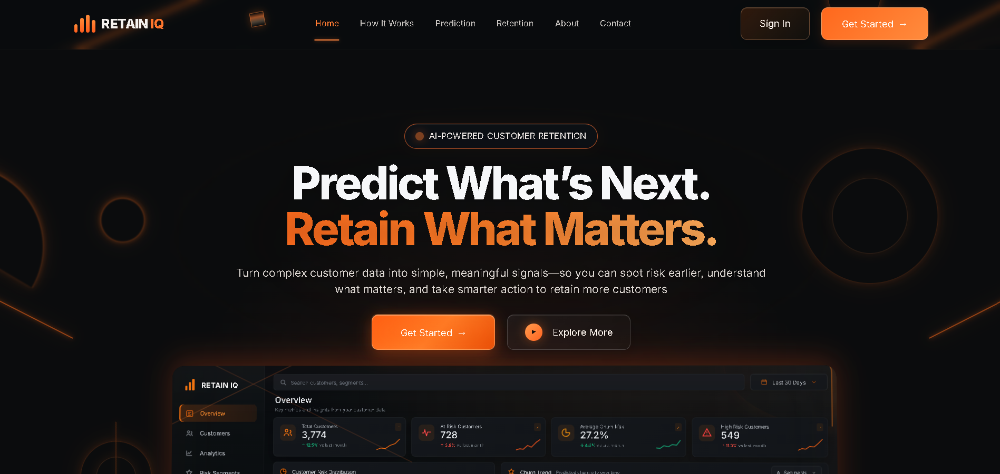
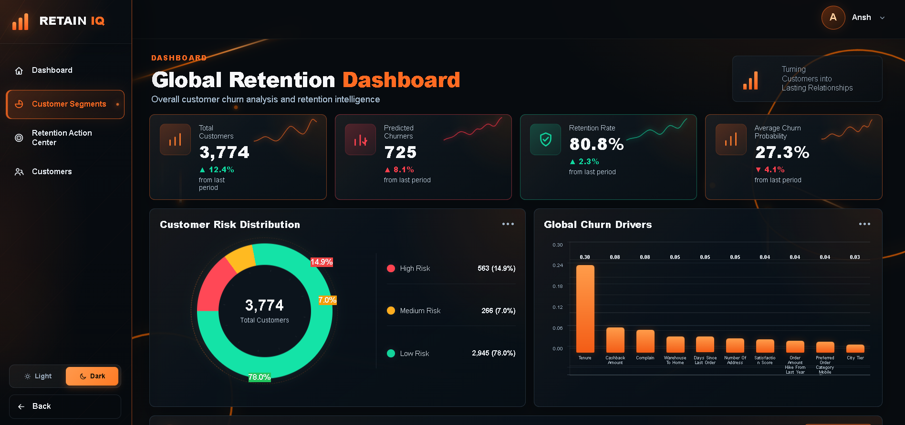
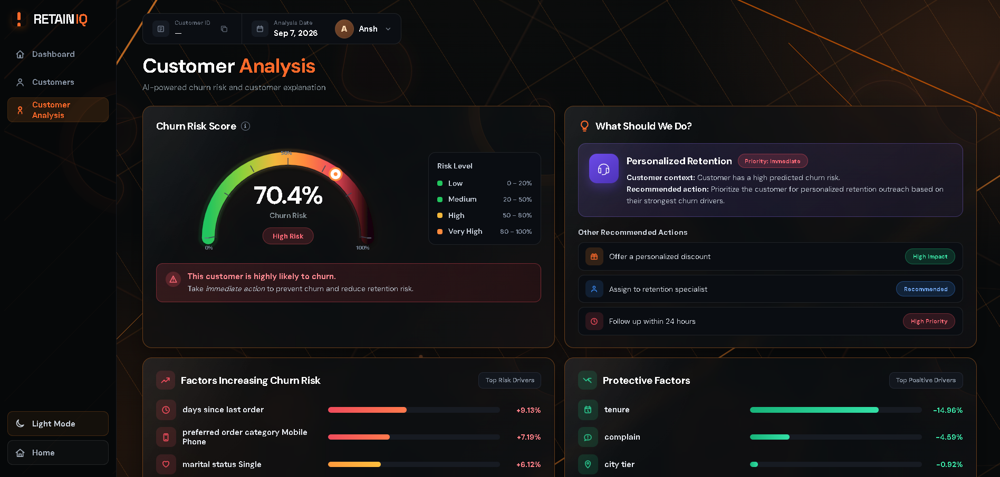

# RetainIQ — Customer Retention Intelligence Platform

RetainIQ is an end-to-end machine learning platform for predicting customer churn, explaining predictions, identifying high-risk customers, and recommending actionable retention strategies.

## 🚀 Live Demo

**[Launch RetainIQ](https://retainiq-production.up.railway.app)**

> Try the deployed web application directly from your browser.

## ✨ Features

- User authentication and secure sessions
- Individual customer churn prediction
- Batch CSV/Excel churn prediction
- Sample dataset workflow
- High / Medium / Low risk classification
- SHAP-based individual prediction explanations
- Business analytics and customer segmentation
- Customer risk exploration and filtering
- Retention action recommendations
- MySQL data persistence
- Per-user dataset isolation
- Ownership and security validation
- Automated testing

## 🧠 What RetainIQ Does

RetainIQ follows the complete decision-making pipeline:

```text
Customer Data
      ↓
Churn Prediction
      ↓
Risk Classification
      ↓
Explain Why
      ↓
Prioritize Customers
      ↓
Recommend Retention Action
```

The goal is not simply to predict churn, but to turn an ML prediction into a practical business decision.

## 📊 Risk Levels

| Churn Probability | Risk Level |
|---|---|
| `>= 0.70` | High |
| `0.40 – < 0.70` | Medium |
| `< 0.40` | Low |

## 🖥️ Screenshots

### Landing Page



### Bulk Retention Dashboard



### Customer Analysis



## 🛠️ Technology Stack

- **Python**
- **Flask**
- **Pandas**
- **NumPy**
- **Scikit-learn**
- **XGBoost**
- **SHAP**
- **MySQL**
- **HTML / CSS / JavaScript**
- **Pytest**
- **Docker**

## 🔐 Security

RetainIQ includes application-level security features such as:

- Password hashing
- Session-based authentication
- Protected application routes
- Per-user dataset ownership
- User-scoped dataset and customer queries
- Cross-user ownership validation
- Environment-based secrets and database configuration

## 📁 Project Structure

```text
RetainIQ/
├── Data/
│   ├── processed/
│   └── raw/
├── docs/
├── models/
├── notebooks/
├── scripts/
├── static/
├── templates/
├── tests/
├── .env.example
├── Dockerfile
├── app.py
├── requirements.txt
└── wsgi.py
```

## ▶️ Run Locally

Install the dependencies:

```bash
pip install -r requirements.txt
```

Configure the required environment variables in `.env`, then start the application:

```bash
python app.py
```

Open:

```text
http://127.0.0.1:5000
```

## 🧪 Testing

Run the complete test suite:

```bash
pytest -q
```

Current validation:

**30/30 automated tests passed**

- 22 smoke tests
- 8 ownership/security tests

## 🌐 Deployment

RetainIQ is deployed as a public web application using a production Flask server and persistent MySQL database.

**Live application:**  
**[retainiq-production.up.railway.app](https://retainiq-production.up.railway.app)**

## 📚 Documentation

Additional project documentation is available in the `docs/` directory, including:

- Architecture
- API reference
- Project documentation
- Final testing checklist

## 👨‍💻 About the Author

### Ansh Tyagi

B.Tech **Artificial Intelligence & Data Science** student focused on building practical AI systems that combine **machine learning, explainability, backend engineering, and real-world decision-making**.

RetainIQ was built around a simple idea:

> **Don't just predict the problem. Explain it. Prioritize it. Act on it.**

---

<div align="center">

## ⭐ RetainIQ

### **Predict. Explain. Prioritize. Act.**

*Turning ML predictions into retention decisions.*

</div>
